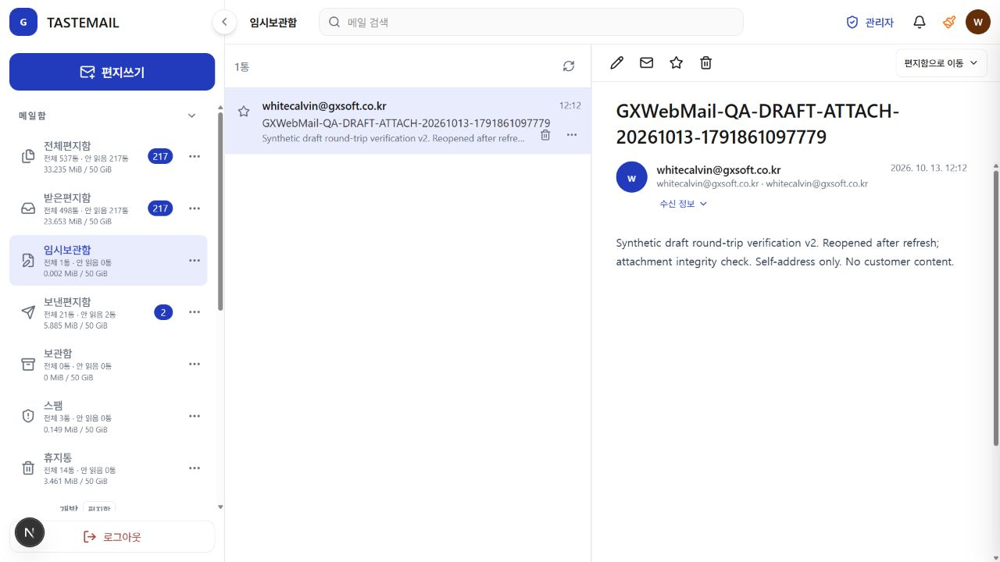
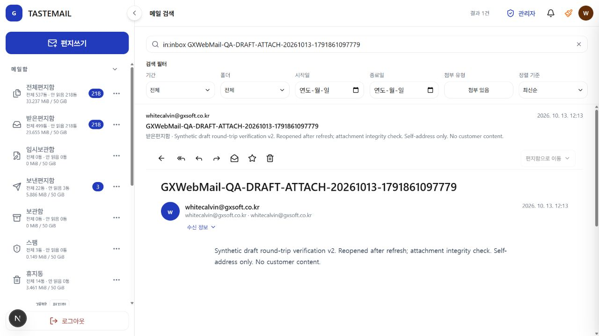

# 신규 초안·첨부 자기 발송 실제 수용 — 2026-10-13

사용자는 현재 관리자 계정에서 새 초안 1개 저장·다시 작성, 합성 TXT 첨부, 자기 주소 발송 1통을 명시 승인했다. 기존 메일 변경·삭제와 외부 수신자 발송은 제외했다. Computer Use 스킬의 실제 웹 UI·파일 선택·다운로드를 사용했으며 세션 토큰/쿠키 추출, 직접 API/DB 조작, 서버 설정 변경은 하지 않았다.

테스트 제목: `GXWebMail-QA-DRAFT-ATTACH-20261013-1791861097779`. 발신·수신은 로그인 계정의 같은 주소 하나다. 본문 v1/v2와 TXT는 고객 내용·인증정보 없는 합성 문구다.

## 실제 단계·결과

1. 신규 작성 내용을 닫기 → 기존 공통 확인 창의 ‘임시 저장’으로 저장했다. 임시보관함 0→1통을 조회하고 새로고침 후 같은 제목·수신자·본문 v1을 다시 열었다.
2. 로그인 주소와 발신 주소가 같은 초안의 ‘임시보관 메일 편집’으로 재작성했다. 본문을 v2로 바꾸고 로컬 합성 TXT 176바이트를 파일 선택으로 업로드했다. UI에서 업로드 완료/첨부1개를 확인했다.
3. 같은 초안을 다시 임시 저장하고 새로고침했다. 임시보관함은 여전히1통이며 v2와 TXT 첨부1개가 유지됐다. 수정 과정의 초안 중복은 관측되지 않았다.
4. 저장된 초안을 다시 편집해 수신자 하나·v2·첨부 하나를 확인한 뒤 보내기를 한 번 실행했다. 대기열 접수 안내만으로 전달 완료를 판정하지 않았다.
5. `in:inbox`와 고유 제목으로 실제 수신 결과1건을 확인했다. 상세의 본문 v2·첨부1개와 임시보관함0통을 조회했다. 검색 상세는 조회 전용이어서 수신 메일의 읽음·별표·소속은 변경하지 않았다.
6. 해당 새 수신 메일의 TXT 링크에서 파일을 다운로드하고 원본과 크기·SHA-256을 비교했다.

| 파일 무결성 | 결과 |
| --- | --- |
| 원본 | `docs/fixtures/self-draft-attachment-20261013.txt` |
| 다운로드 | `C:/Users/whitecalvin/Downloads/self-draft-attachment-20261013.txt` |
| 원본·다운로드 크기 | 둘 다176바이트 |
| 원본·다운로드 SHA-256 | 둘 다 `7242D5A8D70AFA2032BC33E47384DD316C0DA7D6639DBBB820491D7EE7B5DCD7` |
| 바이트 일치 | true |

수집된 console warning/error는0개다. 임시 검수 탭은 닫았으며 사용자의 기존 탭은 변경하지 않았다. 신규 메일·합성 원본·다운로드는 삭제하지 않았다. 발송 뒤 초안이 서버의 정상 발송 처리로 임시보관함에서 사라진 것과 사용자 데이터 삭제 작업을 구분한다.

실패/불명 응답 유도, 예약 발송·취소, 외부 전달, 대용량/여러 첨부, MFA·실제 세션 만료, 다른 계정 격리 및 전체 제품 수용은 이 결과로 완료 처리하지 않는다. 애플리케이션 소스 입력은 바뀌지 않아 기존 성공한 앱 검사·빌드를 재실행하지 않고 문서 diff 공백 검사와 파일 해시 비교만 수행했다.
