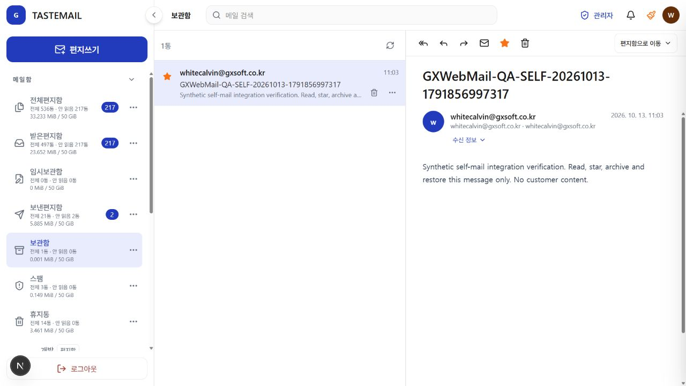
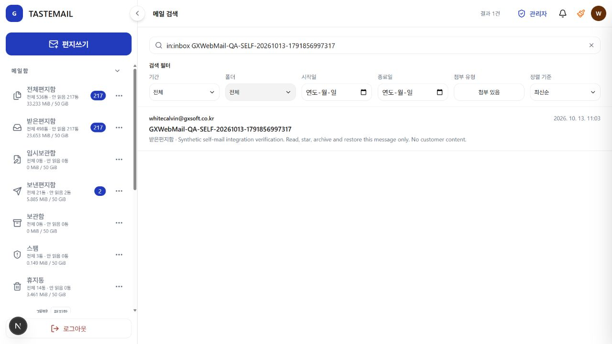
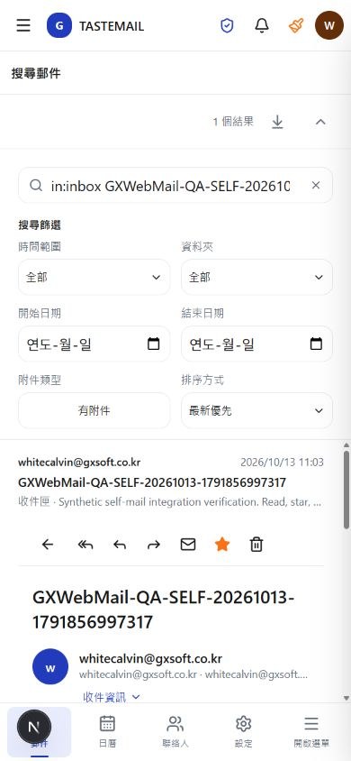

# 신규 자기 발송·상태 변경 수용 — 2026-10-13

사용자는 현재 관리자 계정을 테스트 대상으로 명시하고 진행을 승인했다. 관리자 권한 변경은 수행하지 않았다. 범위는 신규 자기 발송 1통, 해당 메일의 읽음·별표·보관함 이동·받은편지함 복원이다. 외부 수신자, 기존 메일 변경, 삭제, 첨부 업로드, 추가 발송은 제외했다.

Computer Use 스킬의 실제 UI 조작·관찰 경로를 사용했다. 토큰/쿠키 추출, 브라우저 fetch, 직접 DB 또는 서버 변경 없이 기존 7540 웹메일 화면에서 진행했다.

테스트 식별자: `GXWebMail-QA-SELF-20261013-1791856997317`. 본문은 고객 정보를 포함하지 않는 합성 검증 문구다. 발신·수신은 현재 로그인 계정의 같은 주소 하나만 사용했다.

| 단계 | 실제 관측 |
| --- | --- |
| 발송 | 보내기를 한 번 눌렀고 발송 대기열 접수 안내를 확인했다. 이 안내만으로 전달 완료를 판정하지 않았다. |
| 수신·검색 | 식별자 검색 결과 1건, 받은편지함 소속과 합성 본문을 확인했다. |
| 읽음 | 받은편지함에서 신규 메일을 열기 전 제목이 unread 스타일이었다. 열린 상세의 버튼이 ‘읽지 않음으로 표시’로 바뀌었고 새로고침 후에도 유지됐다. |
| 별표 | 신규 메일에만 중요 표시를 적용했다. 서버 재조회 후 같은 행의 체크 상태 1과 주황색 별표를 확인했다. |
| 보관함 이동 | 신규 메일만 이동했다. 받은편지함은 498→497통, 보관함은 0→1통으로 바뀌고 보관함에서 같은 식별자·본문·별표·읽음 상태를 조회했다. |
| 원위치 복원 | 받은편지함으로 이동했다. 받은편지함 498통, 보관함 0통을 재조회했고 페이지 새로고침 뒤 같은 신규 메일의 별표와 읽음 상태가 유지됐다. `in:inbox`와 식별자 검색 결과 1건으로 복원 소속을 별도 확인했다. |

첫 새로고침 직후 DOM locator의 대기 시간이 초과됐으나 발송/변경을 반복하지 않았다. 실제 AX 상태의 해당 신규 행을 다시 확인하고 후속 읽기만 진행했다. 수집한 콘솔 warning/error 항목은 없었다.

신규 메일은 삭제하지 않고 받은편지함에 읽음·별표 상태로 남겼다. 외부 전달, 첨부/초안/예약, 실패·불명 결과 유도, MFA·세션 만료, 다른 계정 격리, 전체 다국어/모바일 수용은 이 검증으로 완료 처리하지 않는다. 검색 상세는 현재 조회 전용이라 상태 변경 컨트롤이 비활성임을 확인했고 변경은 받은편지함 상세에서 수행했다.

이 작업은 운영 UI 검증과 문서 기록뿐으로 애플리케이션 입력은 바뀌지 않았다. 기존 앱 검사·빌드를 다시 실행하지 않았으며 문서 diff 공백 검사만 수행했다. 전체 연동 목표는 아직 미완료다.

## 후속: 10개 언어 desktop/mobile 상세 검수 및 수정

같은 신규 테스트 메일을 `in:inbox`와 식별자로 한정해 조회했다. 목록과 검색 상세 열기는 읽기 전용이며 추가 메일 발송·플래그/소속 변경은 하지 않았다. 경로별 로케일은 현재 `i18n/routing.ts`의 열 가지와 대조했다.

첫 모바일 관찰에서 문서 폭은 390px였지만 내부 결과 스크롤 영역이 clientWidth 380px / scrollWidth 407px, 상세 헤더가 340px / 387px로 넘쳤다. 전역 scrollWidth만 검사하면 놓치는 오류였다. 공통 Tooltip이 호출자의 `hidden lg:inline-flex` 앞에 무조건 `inline-flex`를 추가해 숨김과 충돌했고, 모바일에서 이동 드롭다운이 표시된 것이 원인이었다.

`components/ui/Tooltip.tsx`가 명시적인 기본 `hidden`을 받으면 기본 inline-flex를 추가하지 않도록 수정했다. responsive `lg:hidden`은 기존 기본 inline-flex를 유지하며, 기존 포털/키보드/aria/이벤트와 검색의 변경 잠금은 그대로다. Next.js·Tailwind 스킬에 따라 페이지별 우회가 아닌 공통 컴포넌트에서 해결했다.

수정 후 모든 해당 입력이 바뀐 GUI 게이트를 다시 확인했다:

| 대상 | desktop 1280×720 | mobile 390×844 |
| --- | --- | --- |
| ko, en, de, es, fr, it, pt, ja, zh, zh-hant | 10/10 목록·상세·iframe 표시 | 10/10 목록·상세·iframe 표시 |
| 문서 clientWidth / scrollWidth | 1280 / 1280 | 390 / 390 |
| visible/auto/scroll 영역의 내부 가로 넘침 | 모두 0개 | 모두 0개 |
| 본문 iframe 폭 | 모두 640px | 모두 308px |
| 수집된 콘솔 warning/error | 모두 0개 | 모두 0개 |
| 이동 드롭다운 wrapper | flex 유지 | none으로 기존 모바일 정책 유지 |

탐색/locator가 한 번 시간 초과했지만 같은 살아 있는 탭의 완료 상태를 재관찰하고 해당 첫 단계부터 재개했다. 메일 mutation이나 서버 재시작을 반복하지 않았다. temporary viewport를 reset하고 검수 탭을 닫았다.

검증: 신규 실제 Tooltip SSR 회귀 1개(기본/숨김/반응형/비활성 접근성), 기존 reading-pane tooltip AST 검사, 검색 상세 공유·변경 격리 검사, IconButton tooltip 검사 통과. 전체 lint 종료0, production CSS/TypeScript·410페이지 빌드 종료0, BUILD_ID `9DWYni9J47bINstJSZD_u`, 변경 파일 diff 공백 검사 통과. 번역 catalog는 바뀌지 않아 앞선 3384키/1557사용 호출 검사를 중복 실행하지 않았다. Node 검사에는 별도 optimized 모드가 없으며 production 빌드와 실제 화면 검수를 별도 증거로 기록한다. 전체 제품/실제 단말/다른 메일 레이아웃의 수용으로 확대하지 않는다.

